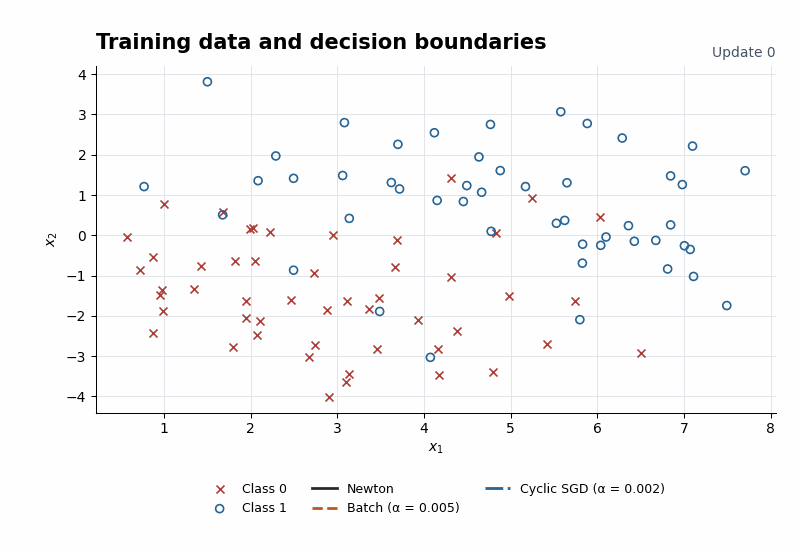
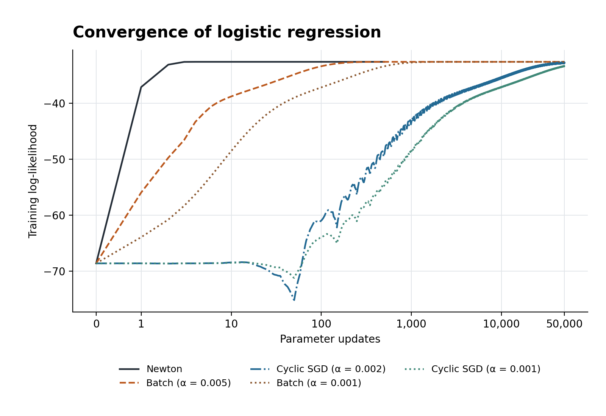

# TNK129 Lab 2 · Logistic regression

How many parameter updates does it take to fit the same binary classifier? This lab compares Newton’s method, full-batch gradient ascent, and cyclic stochastic gradient ascent on 99 training examples. Each method starts from zero and maximizes the same training log-likelihood.



## Run the lab

The program was tested with Python 3.9.6. From a terminal on macOS or Linux, run

```sh
git clone https://github.com/nomantabassum38/Lab-2-Logistic-regression.git
cd Lab-2-Logistic-regression
python3 -m venv .venv
source .venv/bin/activate
python -m pip install -r requirements.txt
python tnk129_lab2_logistic_regression.py
```

The script prints the Newton coefficients and convergence counts, then saves both figures as PNG, PDF, and animated GIF in `lab2_results/`. It runs without a graphical display.

## The four tasks

The [Python implementation](tnk129_lab2_logistic_regression.py) is divided into four numbered sections. The rows of [q1x.dat](q1x.dat) contain the two input features. The corresponding rows of [q1y.dat](q1y.dat) contain the binary labels. There are 50 examples of class 0 and 49 of class 1.

| Task | Implementation |
| --- | --- |
| 1 · Newton’s method | Add an intercept and fit three coefficients using the gradient and Hessian of the log-likelihood. |
| 2 · Decision boundary | Plot the two classes using distinct markers and overlay the fitted boundaries at a predicted probability of 0.5. |
| 3 · Full-batch gradient | Use all 99 examples in each update. Compare learning rates of 0.005 and 0.001 against Newton’s method. |
| 4 · Stochastic gradient | Update from one example at a time, cycling through the rows in file order. Compare learning rates of 0.002 and 0.001 with the other methods. |

## Results

Newton’s fitted decision boundary is **−2.620512 + 0.760372 x₁ + 1.171947 x₂ = 0**. Points on the positive side of the line have a predicted class-1 probability above 0.5.



The table gives the first update whose summed training log-likelihood came within 0.5 of Newton’s final value (−32.585596). Newton ran for 500 updates. Each gradient experiment ran for 50,000.

| Method | Learning rate | First update within 0.5 |
| --- | ---: | ---: |
| Newton | — | 3 |
| Full batch | 0.005 | 124 |
| Full batch | 0.001 | 619 |
| Cyclic stochastic | 0.002 | 28,893 |
| Cyclic stochastic | 0.001 | Unreached after 50,000 |

Reducing the full-batch learning rate fivefold took about five times as many updates to reach the threshold. An update has a different cost for each method. Newton uses all examples and solves a three-parameter linear system, full batch uses all examples to compute a gradient, and cyclic stochastic ascent uses one example for its gradient.

| Figure | PNG | PDF | Animation |
| --- | --- | --- | --- |
| Decision boundaries | [View](lab2_results/01_decision_boundaries.png) | [Download](lab2_results/01_decision_boundaries.pdf) | [Play GIF](lab2_results/01_decision_boundaries.gif) |
| Optimization convergence | [View](lab2_results/02_optimization_convergence.png) | [Download](lab2_results/02_optimization_convergence.pdf) | [Play GIF](lab2_results/02_optimization_convergence.gif) |
